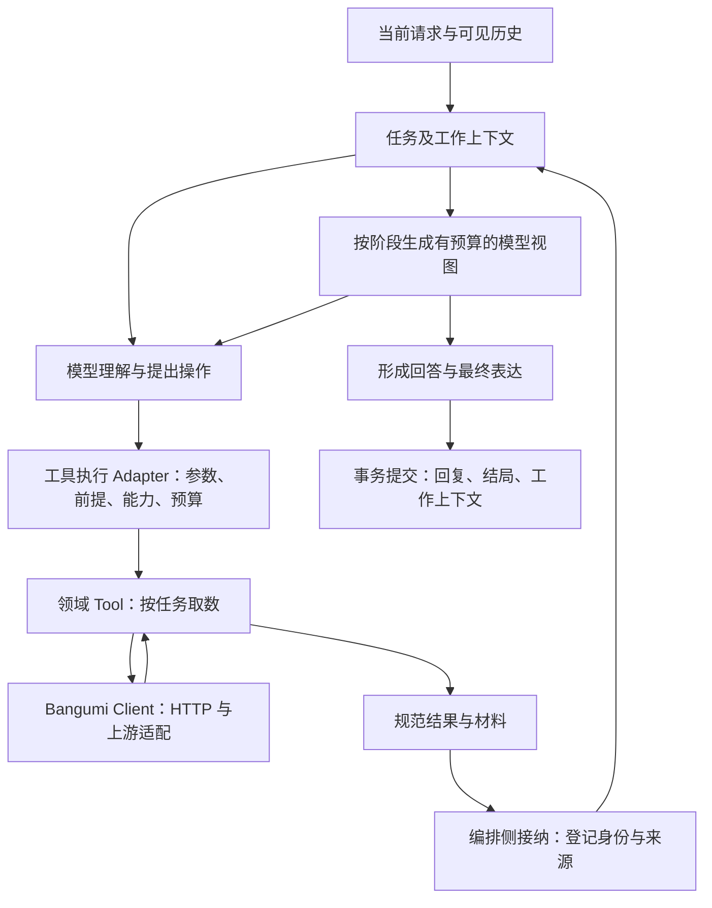

# Agent Tools 与工作上下文：整体设计

> 状态：待实施方案，2026-10-30。范围是现有Bangumi只读取数及材料流转，不是新增产品路线图。
> 产品范围遵循 [PRODUCT](../../PRODUCT.md)，推进次序由 [ROADMAP](../../ROADMAP.md) 维护。
> 本次只设计；不修改生产工具、Prompt、存储或运行服务，不执行新的模型/API调用。

## 1. 问题与目标

这里的Tools系统包含“模型能提出什么操作、程序怎样执行、结果怎样进入后续工作”，
不能只理解为一组HTTP endpoint的包装函数。C2不是证明全部工具都应推倒重来，而是暴露交接合同缺口。

设计依据：

- [正式C1–C5运行](../Test/c1-c5-formal-trace-2026-10-30-run1.md)：C1取得ID，C2模型输入未继承该ID；
  模型提出0且边界执行；失败后未重新搜索；最终失败说明泛化。
- C3/C4显示工具取回、推理看见、Render保留是不同集合，正文、身份和转载限定可能分别丢失。
- [C5对照](../Test/c5-render-contrast-2026-10-30.md)：修改人格块/任务命名没有消除观点越界。
  工具与材料合同能提供归属基础，不等于已经解决代用户表达的语义问题。
- [一手资料与适用取舍](../product/agent-tools-design-references.md)：任务化工具、输出合同、材料/消息/状态分离。

目标：给定用户当前问题，能明确回答“对象是谁、依据是什么、模型看到了什么、操作为什么允许、
哪些部分取得/失败/未执行、下一轮能继续用什么”。自然语言回复不再是业务信息延续的唯一载体。

开工四问：涉及工具、上下文/记忆、编排、表达和验证；取数模块处于数据层，工作上下文由编排侧接纳；
依赖仍从application/agent指向tools/clients/schemas，不允许下层导入AgentState；服务现有连续共读链路。

## 2. 当前资产与需要收敛的职责

| 当前位置 | 保留的价值 | 需要明确的合同 |
|---|---|---|
| [tools_input](../../schemas/tools_input.py) | Pydantic v2参数与描述 | 统一正ID、真实枚举、跨字段约束；结构合法不等于对象正确 |
| [bgm_tools](../../tools/bgm_tools.py) | 已按部分任务聚合的领域操作、能力开关 | 工具说明、注册、前提和结果类型一致；不让返回中的_next充当强制流程 |
| [clients](../../clients/client.py) / [base](../../clients/base.py) | HTTP、认证、重试、上游清洗 | 供应商差异与稳定错误类别留在这里；业务只读不等于HTTP只用GET，搜索实际使用POST |
| [sanitizers](../../clients/sanitizers.py) | 规范化、降噪、评论身份与样本字段 | 区分规范材料与模型节选；缺失不造0，截断不冒充完整 |
| [ToolNode](../../agent/graph.py)及adapter | 单一执行seam、并行、正式Trace | 参数/前提校验、结果接纳、模型投影和状态增量有清楚归属 |
| [short_term](../../agent/memory/short_term.py) | token预算、结构化整块裁剪 | 裁剪的是本次模型视图，不是唯一业务材料；重要身份及限定不可静默消失 |
| [main](../../main.py) / [observability adapter](../../agent/observability.py) | 当前来源绑定、资料结局和结果观测 | 不再分别通过任意dict形状猜同一工具状态；从统一结果派生各自视图 |
| [conversations](../../application/conversations.py) / [sessions](../../sessions/store.py) | 独立执行、事务、恢复、删除 | 除可见历史外，持久化有来源的工作上下文；不与用户确认背景混写 |

特别注意：搜索结果目前含“拿到ID后必须调detail”的_next文字，它与“够用就停”的策略并不一致。
这是工具描述与策略耦合的实例；不是证明所有detail调用都多余。

## 3. 总体形式：领域操作 + 结果接纳 + 工作上下文

同一份规范材料可以有推理和最终表达两个视图；每个视图明确保留/省略了什么。
Trace观察这条链路，不作为业务材料库或下一轮恢复来源；生命周期继续由现有应用合同负责。

不增加万能“回答Bangumi问题”工具，不逐个endpoint机械注册工具，不新增多Agent或MCP部署。
Anthropic的任务化设计与高信号返回支持这一方向，但具体对象确认和保存规则由本项目定义。
来源：[Writing effective tools](https://www.anthropic.com/research/writing-tools-for-agents)。

## 4. 工具对Agent负责的Interface

工具Interface包含用途、输入、适用前提、返回材料、失败含义和覆盖限制，不能仅写函数签名。
一个工具聚合几次只读HTTP请求是实现细节，但每部分结果必须可区分。

### 工具目录

复用并收敛get_agent_tools与工具配置，不建立另一套平行注册表。每个目录项明确：

- 稳定名称、版本、简洁用途与不适用情形；输入/输出schema。
- 对象类型和是否需要已解析对象；需要的认证与可选能力。
- 返回哪些资料维度、是否仅摘要/索引、返回量上限。
- 业务副作用属性；本轮全部是只读，不含发帖、评分、收藏等写操作。

目录描述能力，不硬编码“所有搜索后必须取详情”等通用链路。
能力可用性先由实际注册/配置/权限确定；分类结果是选择提示，不能授权不存在的能力，
也不能把“不需要取数”自动解释为“没有严格任务要求”。本方案不新增一套意图分类器。

### 输入与行动前提

所有对象ID正数且带明确类型，subject/person/character/episode/blog不能只凭同一数字混用。
枚举采用上游真实允许值；例如subject_type不能因ge=1/le=6而接受不存在的类型5。
认证、owner、session、凭据、执行期限从运行上下文注入，不由模型填写。

输入schema负责格式与取值；执行Adapter负责当前能力、对象绑定和预算：

- 0、负ID、错误类型在HTTP之前返回稳定参数错误，actual_execution=false。
- 用户直接给的合法链接/ID可以进入明确的对象核验路径，不要求先搜名字。
- 模型新提出的正ID不能仅因“是整数”就获得已确认对象身份；需要用户输入、已知材料或核验结果支持。
- 未确认对象时提供明确的needs_resolution结果及可用动作；模型可以搜索或澄清，程序不替它选首个候选。
- 已有足够且仍有效材料时允许不调工具；不把首轮强制调用当作任务完成保证。

不在本轮设计中固定“必须动态隐藏所有依赖ID的工具”等机制；实现需比较拒绝无前提调用与能力提示的实际效果。

## 5. 统一结果：结构化且保留含义

沿用Pydantic v2，新增中立的输出合同。共同信封统一，领域payload按类型建模，
不把评分、原评、放送日期强塞成无类型的长文本列表。

| 内容 | 必须表达的含义 |
|---|---|
| schema_version / operation | 用哪个版本解释哪项领域操作 |
| status | ok / partial / empty / error，按实际请求的资料部分计算 |
| entities | 类型、ID、名称及来源；搜索项首先是候选，不自动变为当前对象 |
| data | SubjectSummary、SubjectDetail、OpinionSample、TrendSnapshot等有类型payload |
| coverage | 每个维度是data/empty/error/not_requested/unsupported；正文、节选、摘要、索引另行标明 |
| scope | 对象、筛选、排序、分页、样本/总量的已知含义、榜单类型和范围 |
| provenance | 来源能力/路径标识、安全URL、retrieved_at；上游未提供数据时点则unknown，不冒充采集时间 |
| issues | 稳定错误code、受影响维度、可恢复性及安全说明；不传认证头和任意HTTP错误正文 |

result_id和tool_call_id的关联由编排Adapter赋予，底层工具不依赖AgentState或图运行对象。
域结果不负责用户可见最终话术，也不把HTTP成功等同回答正确。

示意：用户请求comments与reviews，前者取得样本、后者超时，则status=partial，
两个维度分别为data/error。若两者均成功返回空集合才是empty。
board未实现属于unsupported；若用户只要求一条短评，它不是必然阻断任务的缺口。
“合法参数对应的对象未找到”“连接失败”“未执行”“正常空样本”不能都写成暂无资料。

错误类别首批覆盖invalid_arguments、needs_resolution、not_found、authentication_required、
permission_denied、rate_limited、timeout、transport_error、upstream_error、invalid_response、internal_error。
未知错误保留unknown，不按异常字符串猜精确根因。取消沿生命周期传播，不被工具包装成普通成功或空结果。
重试仍由Client在总deadline内负责可恢复的只读传输失败；invalid_arguments/needs_resolution不重试原调用。

输入/输出结构合同可参考MCP，但不引入其服务或传输层。schema证明结构一致，不能证明事实可靠或对象选对。
来源：[MCP工具合同](https://modelcontextprotocol.io/specification/2026-07-28/server/tools)。

## 6. 规范材料与模型视图分离

规范材料是已取得、经过安全清洗的数据，不是保存全部HTTP原始响应，更不宣称取得整个站点。
完整性只相对于本次获授权的请求与有限样本。

规范化先处理上游字段、权限和安全，再保留任务可能使用的身份与内容；模型节选在后。
如上游/抓取上限已经裁剪，记录在哪一步裁剪，不能重新标成完整。
未知评分/排名用null及缺失原因，不能为方便填0；派生数字或标签标明计算方式和依据，不冒充上游结论。

材料至少区分：

- 对象记录：EntityRef={provider, kind, id}与可读名称。
- 事实观察：值、单位/口径、对象、取得时间和来源；评分与趋势分开。
- 社区材料：评论/日志身份、作者、定位、原文或摘要、转载声明、截断与样本范围。
- 用户提供的材料：保留输入来源；被用户引用不等于被用户认领。
- 模型推断/分析：单独归属助手，不自动升级为事实或用户立场。

社区材料键包含provider、所属对象、材料种类和上游ID，避免不同类型/对象的同号混淆；
动态观察按result/取得时点保留版本，不用新值覆盖旧回答当时的依据。

编排侧登记result_id/material_id和来源关系，再生成ModelView：本阶段的必要字段、明确的选取与省略清单。
ID、名称、作者、归属、范围和内容必须能关联；后续操作必需的ID应在视图中可见或由受控Adapter解析，
仅把ID放在数据库或artifact中不会让模型自动知道。

SDK可用ToolMessage.content承载模型视图，artifact或程序记录持有规范结果。
普通dict返回本身不会更新graph状态；状态接纳应由编排Adapter显式完成。
来源：[LangChain tools](https://docs.langchain.com/oss/python/langchain/tools#tool-return-values)、
[ToolMessage artifact](https://docs.langchain.com/oss/python/langchain/messages#tool-message)。

首个迁移允许保持现有dict输出，由现有ToolNode seam接纳后再投影；content/artifact不是必须先切换的前置。
若采用content_and_artifact，变化只限SDK Adapter，并核对直接ainvoke调用方兼容，不让数据层返回graph Command。

预算由统一视图装配负责，沿用实际token计数；优先保留当前对象、用户选中材料、已选原评与必要限定。
不靠固定前N条隐式决定全部候选；省略原因和选择顺序可观察。
长文仍可节选，但保留可回查的已有材料引用；无可取正文能力时明确缺口，不凭引用ID假装读过全文。
不新增通用文件访问工具，不让模型从私有磁盘路径自行读取材料。

## 7. 工作上下文：跨轮继续工作的业务状态

WorkingContext与可见历史、用户确认背景、L2画像及Trace分别负责不同事实：

| 记录 | 内容与归属 |
|---|---|
| 可见历史 | 用户和助手说过什么；不承担所有机器可执行身份 |
| 用户确认背景 | 用户主动填写/确认的材料、纠正、偏好；保留现有修改合同 |
| 工作上下文 | 有来源的对象绑定、选中材料引用、已知资料限制和本轮进展 |
| 规范材料 | 本次真正取得的领域数据/原文及其范围，按会话归属保存 |
| Trace | 哪个阶段看到什么、执行了什么；删除或关闭Trace不能破坏业务恢复 |

首批WorkingContext只需要active_entities、selected_materials和source references等有限字段。
当前任务及用户明确限制在装配时保留；不自动从助手输出提取用户偏好或认可。
材料记录origin role不等于判断其立场，无法确定引用/认领时保持unknown。

对象规则：

- 搜索返回candidate；解析记录保留选择依据、来源与resolved_by，不把模型选择标成用户确认。
- 用户链接/选择、已有明确解析或有依据的模型选择可以建立绑定；同名/续作歧义保持ambiguous。
- 比较任务可以绑定多个对象；并行工具的完成顺序不能决定唯一“当前对象”。
- 用户纠正、换题或明确清除会更新绑定版本；旧材料保留来源，但不继续充当当前对象。
- 下一轮装配使用最近已提交绑定及必要材料，而不是从上一句回复重新抽取ID。
- 实体身份可复用，评分/趋势等动态观察按问题时效重新取得或明确标旧；不能把一次值永久缓存成现在的事实。

这些规则管理程序证据与选择，不保证模型一定正确消歧。错误绑定必须可检查、可纠正。

## 8. 执行、完成与最终表达

沿用现有LangGraph/ToolNode和生命周期；在现有执行seam接纳规范结果，不创建第二套循环。
任务要求和实际资料覆盖用于形成结局，工具status、执行终态、产品质量判定继续分开。

每次模型停止调用工具得到的是一个候选回答，不自动等于任务完成：

- 程序可以核对对象是否明确、请求的取数维度是否取得、引用是否存在且对本阶段可见、预算是否耗尽。
- 对主观问题、观点归属、材料是否足够的判断仍需模型与验收；不把规则检查称为语义正确性证明。
- “请让我重新搜索”的纯文本不是已执行搜索，也不由程序偷偷代发操作。
- 限制阻止继续时，输出对应对象/维度的具体限制；不是将所有失败统一说成网站不可达。
- 部分资料失败不抹掉其他有来源的有效材料；是否足够回答取决于本轮要求。

最终表达使用同一WorkingContext/材料引用生成的视图，保留事实口径、社区归属与缺口；
不能仅凭聚合摘要重新创造来源。引用绑定验证身份与可见性，不证明被引材料支持某个结论。

C5属于“历史材料怎样被用于代用户表达”的后续合同：本方案提供来源和材料身份，
但不认定工具改造、JSON化或多加一个origin字段就能解决生成越界。
本轮不决定移除/合并Render，也不重写人格；它们继续通过原场景和对照验证。

## 9. 存储、生命周期与依赖

不新增数据库服务。schemas中的中立Pydantic结果/材料模型可被clients、tools、agent、sessions引用；
工具不得导入AgentState、HTTP、session_store或业务所有者凭据。

拟定落点：

- schemas：工具输出、实体与材料引用；沿用tools_input。
- tools：现有领域函数、单一目录与输入/输出合同；按职责小步拆分bgm_tools，不预建空层。
- clients：上游HTTP及规范化；无图/会话写入。
- agent：工具执行Adapter、结果接纳与阶段视图；处理图状态增量及并行合并。
- sessions：会话内规范材料和工作上下文持久化，复用SQLite与删除/版本机制。
- application：加载、注入、提交、取消与删除，保证业务事务。

每轮工具结果先保存在执行持有的暂存区；终态提交时，回复、结局、经校验的材料及工作上下文在同一事务保存。
不跨网络请求持有SQLite事务，不在后台另起一个不受会话生命周期约束的写入者。
失败轮已经成功取得的材料可以随终态保存，但须保留所属轮次、来源和资料状态；失败助手文本不自动成为事实。
未提交或删除后的迟到结果不得更新工作上下文。重启恢复已提交材料，不恢复半途工具执行。

schema增加采用可审阅迁移与临时库测试；不修改真实PostgreSQL。两会话/owner隔离，删除联动清理材料和引用，
沿用现有在途删除屏障，不能从L1缓存或迟到任务复活。
材料容量与正文上限在实现中以固定包标定；超限明确storage_limited/omitted，不静默删除用户固定材料。
用户确认背景与程序工作状态分开保存、展示和清除，不能把自动解析冒充用户授权。

## 10. 现有能力如何迁移

| 能力族 | 现有工具 | 迁移重点 |
|---|---|---|
| 对象定位 | search_bangumi_subject | 保留候选ID/类型/名称及匹配依据；撤出强制_next流程，不自动确认首项 |
| 对象资料 | subject/character/person detail、subject episodes/characters | 明确主体及关联身份、缺失值、简介/列表范围 |
| 社区阅读 | subject opinions、episode comments、entity comments | 分维度结局、作者/原文/转载/定位与样本；reviews摘要不冒充全文 |
| 时效发现 | calendar、trending、hot topics | 时间、类型、排序和范围；榜位不等于热度成因，话题列表不等于完整board |
| 用户与日志 | user profile/timeline、blog | 沿用认证与能力开关；私有材料按owner处理，不能自动变成当前用户偏好 |
| 可选检索 | search_local_bangumi | 沿用RAG关闭默认；同一实体/材料合同，不为工具迁移连接数据库 |

不先统一改名或合并全部工具。模型描述、schema、实现、注册与能力范围在同一增量核对。
_error及旧coverage形状通过单一兼容Adapter归一化，新旧路径不得各算一次不同状态。
main来源整理、短期预算和Trace摘要逐步消费统一结果/视图；迁移后旧形状猜测失去写入权。
删除旧函数前核对引用、直接调用、测试及兼容责任，不批量删工具/旧测试。

## 11. 分增量实施与验收

这是本问题的迁移顺序，不是另一份全项目路线图。每步先固定隔离材料，验证后再决定下一步。

| 增量 | 交付 | 退出条件 |
|---|---|---|
| T1 结果与错误合同 | 从搜索与opinions贯通输入/输出schema、类型化错误、覆盖及兼容转换 | 正ID/类型/空结果/部分失败有固定测试；0不触发HTTP，所有消费者对同一结果解释一致 |
| T2 对象与材料延续 | 结果接纳、WorkingContext、SQLite事务保存与下一轮装配 | C1取得的正确对象在C2可检查；歧义/纠正/换题/多对象不误继承；重启和删除不丢身份或复活 |
| T3 阶段视图与结局 | 规范材料到推理/最终表达的有预算投影、具体失败说明 | 身份/范围/转载/截断可追溯；候选回答不等于已执行；局部失败不泛化全站故障 |
| T4 同族推广与收口 | 其他既有工具适配目录、schema和view，撤除重复状态推断 | 所有已注册能力符合合同；旧入口兼容、依赖与安装验证；正式Trace确认同一事实来源 |

候选验收输入：沿用C1–C5，另补必要反例而非全量扩充场景：

- C1后续C2：有明确ID/无ID/歧义候选；正ID但错误类型；用户直接给合法链接。
- 同一整数的subject/person不得互换；比较两个对象时并行返回顺序不改变绑定。
- comments有样本而reviews超时、正常空样本、认证缺失、未支持board分别判定。
- 规范材料存在但未进入模型视图时明确omitted；选中原评跨预算仍保持身份和限定，无法保留正文则如实声明。
- 工具失败但已取得其他有效事实；模型说“再搜索”却无调用；已有材料足够时不强迫重复取数。
- 同owner两会话与不同owner隔离；取消、超时、提交重试、重启、在途删除与容量不足。
- 原C5及用户明确认领的正例继续评判，但不把工具契约通过当作观点忠实性通过。

确定性合同用现有审阅离线入口和临时SQLite；真实模型选择/语义表现另行授权，固定材料和版本做对照。
正式Trace记录规范结果ID、状态接纳、对象绑定版本与视图选择；不新建第二个观测器。

## 12. 当前设计决定与未冻结细节

已给出的设计方向：任务化只读工具、统一领域结果、编排侧接纳、会话工作上下文、阶段模型视图，
以及行动前提/任务结局/最终表达分工。它们服务同一条信息链路，不能拆成相互独立的工具补丁。

实施前仍需通过小范围探针确定：具体结果模型拆分、ToolMessage artifact迁移是否值得、
对象解析如何在现有模型输出中声明、材料配额和动态数据刷新策略。
不因此预建通用工作流DSL、插件总线、复杂知识图谱、自动长期记忆或新的LLM判官。

官方参考的事实与本项目推论见[参考记录](../product/agent-tools-design-references.md)。
它们提供可借鉴的合同与机制，不构成“采用某框架即可保证Agent正确”的承诺。
