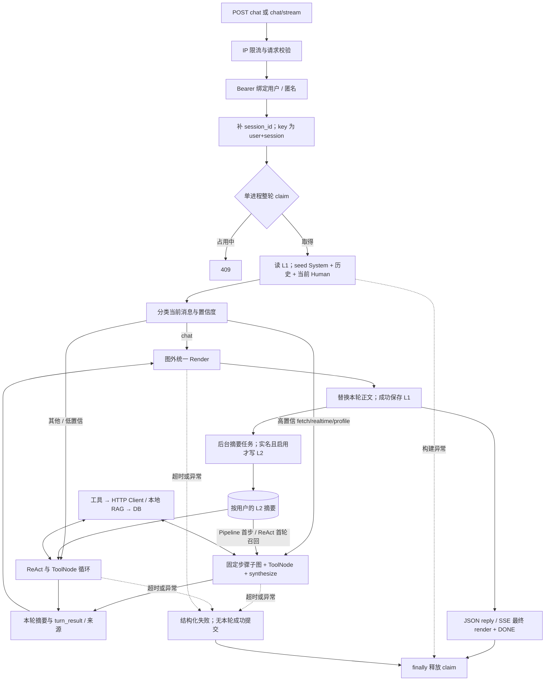

# 系统级代码现状盘点

> 定时点报告：2026-10-28（Asia/Shanghai）。依据：当前 main 工作区，包括未提交修改。用于交付与状态范围讨论；不是开发排期、修复承诺或全系统无缺陷证明。

## 1. 执行摘要

现有资产是可复用的 Agent 后端骨架，尚不是非作者用户可直接使用的完整产品。HTTP 身份绑定、单进程会话互斥、Pipeline/ReAct、工具、最终渲染、来源与失败交接均已有实现。固定材料验证能沿真实编译图和 ASGI 入口走通连续三轮及关键生命周期；真实模型能否稳定选对工具、识别对象、作出忠实判断，本次没有验收。

主要结论：

1. **会话隔离已有基础；历史保存与重启续聊没有完成。** 缓存按 `[user_id, session_id]` 隔离，整轮占用避免同会话并发覆盖；只在一个应用进程内成立。L1 默认一小时 TTL、最多 1000 会话，成功轮保存末尾 fast 20 / deep 30 条消息。L2 是按用户召回的摘要，不是原始历史、会话列表或可恢复的执行检查点。证据：`main.py:266,284,608`、`agent/memory/cache.py:39,56,117`、`database/memory_tables.py:54`；动态 D1、D6、D7。
2. **自运行也有启动交付门槛。** 当前正常启动无条件连接 PostgreSQL、启用扩展并迁移；关掉 L2 不取消启动数据库依赖。依赖清单缺少直接使用的 Alembic 与 zai-sdk，现有本机环境恰好安装了它们。无锁版本文件、应用容器或完整客户端的跟踪资产。证据：`main.py:148`、`database/engine.py:52`、`requirements.txt`，本机包元数据与 Git 跟踪清单。新机器安装与空库迁移尚未验证。
3. **项目方托管的用户自备模型 API 需要新增配置隔离设计。** 当前 Settings、模型和 Bangumi 凭据均为进程配置；HTTP Bearer 只绑定本服务用户。已有认证不能据此证明用户模型密钥、模型地址、embedding 或 Bangumi 授权已经隔离。证据：`core/config.py:18,219`、`agent/llm.py:52`、`clients/base.py:64`、`tools/bgm_tools.py:1368`。这是托管方案的条件性需求，不是给单用户自运行方案强加多租户要求。
4. **失败边界仍有可复现问题。** ToolNode 的异常文本被当作有效数据，并把异常正文送入下一次模型上下文；分类器把供应商异常正文写入日志；RAG 全通道失败会丢失失败原因并退成“未找到”。证据与复现见 §5 E1–E3。没有读取真实凭据或用真实私密材料验证泄漏。
5. **交付入口未定，不应先全面补状态。** 独立 Web 缺客户端，站内组件缺与本后端对接的组件。唯一发现的本机 UserScript 被 Git 忽略，调用另一套模型接口，不能当作 clone 后可得的产品。跨设备可以只是本人连接自有服务器，并不必然要求公众多用户平台。候选差异、成本与替代方案见 §6–7。

## 2. 基线、约束与覆盖

### 2.1 基线和环境

- HEAD：`d15b5f703a4bae2bb2e0fa4ef87531f0b523aa15`，分支 `main`，未切换分支。
- 工作区：`/Users/lichenhao/python/bgm-agent-dev`；已有变更清单见附录 A。现有修改主要在产品/架构/历史文档，另有 `scripts/check_doc_refs.py`；以工作区内容审查，未回退成 HEAD 版本。
- 实际验证解释器：`.venv/bin/python`，Python 3.14.8 / Darwin arm64；`venv/bin/python` 同为 3.14.8，系统 Python 为 3.9.6。没有新建环境或安装依赖。
- 本机已安装：FastAPI 0.141.1、LangGraph 1.2.10、langchain-core 1.5.3、langchain-openai 1.4.1、Pydantic 2.13.4、SQLModel 0.0.39、httpx 0.28.1、pytest 9.1.1、tiktoken 0.13.0、Alembic 1.18.5、zai-sdk 0.2.3。该清单是本机证据，不是可复现安装清单。
- 本次只新增本报告；临时脚本、日志与指纹写入 `/tmp`。没有修改业务代码、配置、依赖或旧报告，没有删除文件、提交、推送或启动常驻服务。

### 2.2 数据与运行边界

未读取 `.env`，未读取或修改 `eval/data`、`eval/results`、`rag/corpus`、`scripts/data`、`docs/Test/test_output`。仅查看源代码中对这些路径的使用，未打开其数据。未读取嵌套 sanitized 仓库，也未将它作为事实源。未连接真实 PostgreSQL、调用模型、embedding 或 Bangumi 服务；未执行迁移、灌库、种子、清理或全量测试。

临时动态脚本在导入应用前禁用 Settings 的 env_file，覆盖凭据为占位值，设置无效且非 5432 的数据库地址；阻断 socket connect/connect_ex/sendto、DNS 与 psycopg2.connect，并通过 Python 审计钩子拒绝 `.env` 和受保护数据文件的打开。ASGITransport 直接调用内存中的应用，不启动 lifespan、不监听端口。结果记录外部访问尝试为 0。没有用修改过的服务实现制造“持久化通过”。

### 2.3 静态覆盖清单

| 范围 | 已追踪资产与结论 | 本次验证边界 |
|---|---|---|
| 产品与架构 | AGENTS、PRODUCT、ROADMAP、README、文档地图、架构蓝图（包括开工四问）；当前闭环与交付委托 | 不把历史愿景/Phase 计划视为待办；没有优化人格提示词 |
| HTTP 与整轮生命周期 | `main.py`、`core/auth.py`、`middleware.py`：输入、身份、session、JSON/SSE、互斥、超时、取消、响应、L1/L2 | 内存 ASGI 固定材料；真实代理、浏览器断网与服务进程退出未测 |
| 图与工具调用 | `agent/graph.py`、state、nodes、routing、helpers、guardrails、config、tool_config | 真实编译图的 fetch 子图与 explore/discuss；realtime/profile 子图静态追踪，未逐一动态跑通 |
| 上下文与最终输出 | reasoning、pipeline、短期压缩、Render 装配与最后回复替换、turn_result、comment 引用 | 不评价文案风格；字符降级验证不代表精确 token 预算验收 |
| 数据与来源 | 工具注册、工具输入 schema、BaseClient、BangumiClient、sanitizers、RAG 三通道及产出信封 | 本次固定材料；未核对上游当前 schema、权限、延迟或样本代表性 |
| L1/L2 与持久化 | SessionCache、MemoryManager、memory_tables；摘要/召回/衰减/UPSERT、用户过滤、后台任务 | 无数据库集成；不读取真实历史；未验证真实长期记忆质量 |
| 初始化与交付 | Settings/LLM 工厂、engine、Alembic env/两条 migration、ORM、requirements、数据库/RAG CLI 及维护脚本入口 | 只静态；源代码存在不等于脚本可以安全地在现有数据库执行 |
| 客户端与工程资产 | Git 跟踪文件、忽略规则、本机 `test/AI.js` 的接口调用与元数据、测试入口/fixtures、CI、许可声明 | 无浏览器执行；忽略资产和本机依赖不计为可分发能力 |
| 测试与旧证据 | 离线入口审阅名单、认证/端点/路由/L1/交接测试；集成/RAG 测试风险；10-25 复测记录 | 旧真实服务证据单列，未冒充本次复测；未执行受保护数据评测 |

这是主路径、边界与交付资产盘点，不是逐行形式证明或完整依赖漏洞/许可证审计。

## 3. 请求、状态与责任流



图中 L2 是背景摘要，不是历史恢复通道。SSE 在生成器开始前占用 claim，由 `ReservedStream.__call__` 的 finally 释放；取消时尽力保存 `final_state` 的 L1、不写 L2。推理与 Render 共享超时，初始状态构造和后置缓存保存不在该 wait_for 内。代码：`main.py:291,438,608,1231`。

| 模块 | 当前责任与复用价值 | 边界/代价 |
|---|---|---|
| HTTP 应用层 | 身份、整轮排他、上下文恢复、图调用、最终渲染、来源、保存与响应 | `main.py` 是主要集成面，JSON/SSE 两套生命周期仍需同时验；不是只改 graph 就能完成状态产品 |
| 图/节点/路由 | 分类、固定工作流和开放探索、工具执行、迭代熔断 | 父子图消息 reducer 为 append；`_pipeline_node` 只回传增量；无 checkpointer，不能恢复中断执行（`agent/graph.py:_pipeline_node,build_graph`） |
| 数据层 | Pydantic schema、工具 dict、HTTP 重试/结构化错误、字段清洗、RAG 索引卡 | 未见 tools/clients/rag/database 反向 import AgentState 或 main；工具异常兜底仍有 E1，不宜宣称“所有失败均结构化” |
| 人格/Render | 图外最终生成；拿当前摘要、有限来源与最近可见对话 | 不访问数据库；依赖共享 LLM 工厂符合当前方向。最终 Render 是独立模型调用，有延迟与费用，不是字符串格式化 |
| 记忆层 | L1 模型视图裁剪；L2 按用户召回与摘要写入 | 不依赖 AgentState；依赖横切模型工厂与数据层。同步 DB/embedding 实际在 async 调用链内，可能阻塞事件循环，见 §5 |
| 横切 | LLM 工厂、日志、telemetry、错误格式化 | Settings/工具注册/图实例是进程级；按用户模型配置需贯穿分类、推理、Render、L2，不能只在 HTTP 加一个 key 字段 |

### 3.1 当前对象、材料、纠正与偏好的实际去向

`ChatRequest` 只有 message、depth、output_style、session_id、user_id（`main.py:71`）。对象 ID、页内选文、材料来源、进度、剧透边界和纠正都混在自由文本中；没有结构化活动对象或偏好字段。动态传入 context 会被默认 extra-ignore 丢弃，不能把客户端暂时加字段当作已有接入。

分类器只拿最后一条 Human（`agent/helpers.py:20`、`agent/nodes/classify.py:232`），不是整个会话；下游 Pipeline/ReAct 才拿历史。新一轮的“它/第二季/刚才那条”能否选对分支仍取决于当前分类和模型，不是显式实体状态机。

L1 原消息跨 HTTP 暂存，推理时 `manage_memory` 裁剪局部副本，SystemMessage 单独保留；历史工具结果压缩，当前社区材料按记录预算裁减（`agent/memory/short_term.py:133,188,371,1029,1060`）。Render 的历史只取最近六条可见用户/助手消息，每条最多 1500 字，不含工具全文（`main.py:1148`）。纠正只要仍在窗口里能传到 Render；没有对纠正设独立寿命，早期对象/偏好仍会随 TTL、条数或 token 窗口丢失。

本轮 turn_result 从当前 Human 之后的工具转录汇总；保存状态、缺失维度、有限来源。comment 引用按 ID 绑定作者和 URL，未知/不完整标记会降级；**没有标记的引文或额外事实不受此机制完整保证**（`main.py:761,885,937`）。coverage 中 board 未覆盖会使结果 partial；这不是“后端完全失效”，也不是事实质量已验收。

条目短评保留作者、ID、全文、时间、分页锚点与样本数（`clients/sanitizers.py:550`）；reviews 只保留摘要并标明 summary。单集/人物/角色等通用评论使用 `sanitize_comments` 压成字符串、截到 200 字，缺逐条作者/定位/截断信封（`:499,735`），不能将条目短评的可核验能力推广到全部评论工具。这是具体原评讨论的覆盖缺口；若首版包含这些对象，需要对应来源契约，若只提供信号则需明确限制。

L2 每次成功请求后创建后台任务，实名且 MEMORY_ENABLED 时，将当前缓存会话摘要 UPSERT 到 `(user_id, session_id)`；无显式“保存偏好”授权对象、编辑/删除/冲突接口，也没有完整原文记录表。摘要失败可回落为回复片段，embedding 失败可按近期召回，不保证语义相关；还会由多次 tone 结果推断交互风格（`agent/memory/long_term.py:125,286,467,884`）。这与 PRODUCT 的“仅明确且值得长期保留的偏好”存在语义差距，不能把旧画像表重新启用当作补齐。

## 4. 动态命令、结果与证据分级

### 4.1 本次命令与隔离方法

在仓库根目录运行：

```bash
TIKTOKEN_CACHE_DIR=/private/tmp/bgm-agent-tiktoken .venv/bin/python scripts/test_offline.py
```

退出 **2**：`Tokenizer cache missing. Prepare cl100k_base separately and set TIKTOKEN_CACHE_DIR.` 该路径与系统临时目录默认 data-gym-cache 均不存在。**本次没有收集/运行该入口的单元测试，不能报告它们通过。** 没有下载缓存、装依赖或扩大全量测试。

另外在 `/tmp/bgm_inventory_probe.py` 编写最小探针，运行：

```bash
.venv/bin/python /tmp/bgm_inventory_probe.py > /tmp/bgm-inventory-probe.log 2>&1
```

最终退出 **0**，脱敏结果保存在 `/tmp/bgm-inventory-probe-results.json`。脚本与日志仅为本机临时证据，不随 clone 分发。脚本指纹见附录 B。关键方法：保留真实 main、LangGraph 编译/路由、ToolNode、缓存和结果处理，替换分类结果、模型响应与四个工具的返回；普通请求经 httpx.ASGITransport，取消另用合成 ASGI task。关闭 L2 写入，固定本地材料，不涉及真实网络/DB。tiktoken.get_encoding 显式抛普通 RuntimeError，使用代码已有 len//2 降级；**这不是离线测试集的替代通过，也不是精确 token 测试。**

初次探针把同步 bind_tools 错用为 AsyncMock，导致模拟节点失败；已改为 MagicMock + AsyncMock.ainvoke 并加入实际工具断言后重跑。增加工具异常检查时发现预期失败状态实际为 success，保留为 E1 的反例。以下只使用最终完整运行结果。

### 4.2 场景覆盖结果

| ID | 场景与实际观察 | 可以证明 / 尚不能证明 |
|---|---|---|
| D1 | 同 session 连续三轮：评分/近期热度/前作比较 → 续作演出感受 → 原评讨论。第一轮实际执行 search/detail/trending，后二轮执行 opinions；缓存 Human 数依次 1/2/3，均 HTTP 200、partial/incomplete | 真实图、工具交接、同对象文本连续性、board 缺口传播成立；分类与输出均编排为固定值，各工具统一返回同一口碑信封，**不证明评分/趋势 schema、真实比较、作品归因或引用内容忠实性** |
| D2 | 真实 fetch 子图执行 search → detail → synthesize；缓存仅一条 Human | 增量包装没有把该次输入复制；realtime/profile 子图未动态覆盖 |
| D3 | 后续纠正“不是剧情，是演出；不要剧透”传到 Render，最近历史可见；“第二季”加 context 的请求解析后无 context | 纠正交接存在；对象歧义解析、长期剧透约束和首次澄清策略未验收 |
| D4 | 空工具材料得到 empty/incomplete；模型节点异常得到 failed，响应无合成私密正文 | 空与模型失败可区分；ToolNode 抛异常反例见 E1 |
| D5 | JSON/SSE 成功回复和 turn_result 相同，SSE 有 DONE；两入口的超时和图异常都返回失败结局、session_id 并释放占用 | 两入口本轮核心合同一致；SSE 不是 token 流，不含 JSON 的全部统计字段。真实 HTTP/代理缓冲未验 |
| D6 | 同 session 并发第二请求 409；另一 session 200；alice/bob 使用同一 session 字符串读到各自历史；冒认 user_id 为 403 | 当前单进程用户/会话隔离成立；跨 worker/实例、负载与授权撤销未验证 |
| D7 | JSON task cancel 与已进入 __call__ 的 SSE task cancel 均释放 claim；重建缓存实例后旧记录为空 | 单次合成取消清理成立；这不是浏览器断网/真实服务重启验收。无持久恢复资产，见 §7 |
| D8 | 未知 comment:999 的合成断言被替换，状态降 partial | 显式未知来源防线有效；未标记引文、URL 永久可达与上游真实性未验证 |
| D9 | 社区材料在字符降级下裁减后仍可 json.loads；超预算历史裁剪仍保留 SystemMessage | JSON 结构与系统消息不丢；精确 token、极长材料、多工具总预算、历史压缩所有形状未验证 |
| D10 | 两个先后搜索各空一次，计数为 1，路由继续 reasoning；同批并行空搜索才是既有测试明确约定 | 这是策略/文档口径差异，见 §5 C3，不能仅凭名称定为回归 |
| D11 | 分类器收到合成供应商异常，日志包含同一私密标记；ToolNode 异常正文进入下一次模型上下文 | 已确认两处失败脱敏边界问题；未使用真实秘密，未证明实际用户曾泄漏 |
| D12 | RAG 三通道全部替身抛异常，_unified_search 返回 [] | 故障与空结果区分丢失，见 E3；未连接本地 RAG 数据库 |

### 4.3 旧证据与未执行项

[10-25 复测记录](Test/acceptance-followup-2026-10-25.md) 记录过离线 544 passed，以及关闭 lifespan/记忆、阻断 PostgreSQL 后的有限真实 HTTP。其 S1 缺趋势、S2/S3 缺 board 与归因/额外断言核验。这是旧提交与旧环境的证据，不是本次计数或当前通过率；没有读取受保护的原始输出进行复算。

本次未执行：真实模型/API（未授权费用）、数据库集成/启动/迁移（未提供已证明隔离的空环境）、完整离线集（缺缓存）、真实浏览器入口（无成品）、真实重启/多 worker/跨设备/长时间负载（缺对应能力或运行条件）。各项最小补验条件见 §9。

## 5. 问题清单：代码错误、产品缺口与条件性需求

修复方向仅说明可选择的工程落点，不代表已批准修改或排期。高置信=代码路径与固定材料证据相符；静态风险不虚构成线上事故。

| ID / 类型 | 触发 → 影响 | 证据与根因 | 置信度与修复方向 |
|---|---|---|---|
| E1 代码错误：ToolNode 失败被标为有效数据 | 工具抛异常 → 本轮 sources.outcome=data、status=success/unverified；异常正文进入下一次模型上下文 | `agent/guardrails.py:153` 直接插入异常正文返回纯文本；`agent/graph.py` 所有 ToolNode 注册该处理器；`main.py:1064` 将非空非 JSON 视为 data。D4/D11：合成抛错后 status=success，第二次模型输入含私密标记 | 高。统一工具错误信封并脱敏，结局还应识别 ToolMessage 的 error 状态；检查所有 ToolNode。当前固定 Render 未复述正文，不能据此断言泄漏防护充分 |
| E2 代码错误：日志失败脱敏不完整 | 分类器供应商异常含请求材料/凭据相关正文 → 写入服务日志；DEBUG 也记录用户与工具内容 | `agent/nodes/classify.py:163` 日志 `%s` 接异常本身，D11 复现；`:149` 无 tool_calls 时记录模型正文，`:254` INFO 记录用户输入前 80 字；`agent/nodes/reasoning.py:_log_message_state` DEBUG 记录工具全文。L2、Zhipu、RAG 仍多处直接记录异常 | 分类器异常高；其他内容泄漏面静态高、实际泄漏未证实。日志按类型/安全字段输出，明确内容采集开关与保留策略；不能只保证 HTTP 不暴露错误正文 |
| E3 代码错误：RAG 故障伪装为未找到 | 名称/关键词/语义通道均故障 → 用户得到未找到的建议；上层无法区分服务坏与无结果 | `tools/bgm_tools.py:1047` 每通道 catch 后丢弃错误，`:1292` 空列表转“未找到”；D12 三通道抛错仍 []。允许部分通道成功降级是合理资产，问题在所有失败时也丢失诊断 | 高。保留各通道状态；全失败返回结构化 unavailable，部分成功标覆盖限制，真实空结果单列 |
| E4 配置路径代码不一致 | 修改 EMBEDDING_MODEL 后，L2 仍默认 embedding-2 → 可能和 RAG/向量维度不一致 | `agent/memory/long_term.py:407` 调用 embed_single(text) 未传模型；`clients/zhipu_client.py:98` 默认 embedding-2；`rag/retriever.py:181` 则读取 Settings；维度由表定义读取全局值 | 静态高；默认配置无此差异，非默认真实 embedding 未测。统一显式传递模型/维度契约并验证迁移兼容 |
| G1 产品缺口：活动上下文没有契约 | 页面对象、材料、纠正或剧透约束需跨较长对话保留 → 只能依赖文本推断和窗口寿命 | `main.py:71,608,1148`、`agent/state.py:49`，D3；没有活动对象/引用材料/纠正字段，分类仅看本条输入 | 高。先定义最小可见可修正上下文及保存边界，再复用现有消息流；不直接新增复杂阶段引擎 |
| G2 产品缺口：历史/重启/删除未闭环 | 用户返回或换设备找旧对话、要求清除 → 缓存过期/重启丢失；无列表/加载/删除 API | SessionCache、`main.py` 路由只有 health/chat/stream；`SessionMemory` 只含摘要。clear 只删内存，不删 L2，也不阻止在途任务写回 | 高。历史事实源与工作上下文分开；若选择持久化需明确所有者、保存、删除和恢复语义，详见 §7 |
| G3 产品缺口：L2 不等于明确长期偏好 | 实名且默认启用记忆 → 自动摘要整段对话、tone 推断；临时感受/他人引文有机会进入长期材料 | `core/config.py` MEMORY_ENABLED=True；`main.py:1231`；`long_term.py:286,467,884`。无需等待整场会话结束即每轮摘要；召回有 user_id 过滤是可复用资产 | 写入机制高、错误记忆实际比例未测。若开放长期偏好，需明确确认、修正/撤销/冲突与可解释读取；不复活 L3 |
| G4 产品缺口：社区读取覆盖有限 | 用户要完整 board 上下文或长评全文 → comments/reviews 摘要不能满足；无 token 时 get_blog 未注册 | `clients/client.py:214` coverage.board=not_covered；`tools/bgm_tools.py:1368`；comment 锚点仅当前分页定位，旧复测已说明 | 高。按任务说明样本与缺失；完整 board 或授权长评链路是否增加需范围决定，不能把 hot topics 当替代 |
| C1 自运行交付缺口：环境不可重建证明不足 | 干净机器按 requirements 安装 → Alembic/embedding SDK 未直接声明；未预置 tokenizer 缓存；无应用打包资产 | `database/engine.py:81` import alembic，`clients/zhipu_client.py:44` import zai；requirements 只有下界；本机二者已安装。Git 跟踪无 lock/应用 Dockerfile/compose | 清单缺失高；干净安装实际结果未测，不声称所有安装必失败。按选定交付确定可重复依赖、缓存准备、启动健康与失败说明 |
| C2 部署条件性需求：启动迁移与数据库权限 | 正常启动 → 不论 MEMORY_ENABLED 均执行扩展和迁移，可能要求建扩展权限并修改已有数据 | `main.py:148`、`engine.py:52`；001 会建表/条件去重/回填，下一迁移回填 popularity；真实库状态未知 | 高。交付应区分初始化/迁移/运行职责及备份恢复；本次不提出无数据库版本的实现承诺 |
| C3 策略口径待确认：连续空搜 | 同一用户轮内先后两次不同参数搜索为空 → 继续到硬上限；同批两个并行空搜索可提前停 | `routes.py:261` 遇最近带 tool_calls 的 AI 即停止；D10；`test/test_routes.py:185` 明确测试“同批并行”，不是跨步 | 行为高、是否缺陷取决于预期。早期“连续两次”的表述过宽；宜先明确成本护栏语义，不据此强行修代码 |
| C4 托管条件性需求：用户自备 API | 两个认证用户希望各用自己的模型供应商/费用 → 当前模型调用仍取同一 Settings | `core/config.py:get_settings`、`agent/llm.py:52`，无用户配置存储/选择。Bangumi token 也为进程级，注册图在 import 时固定，节点工具列表又可动态读取 | 高。需配置作用域贯穿所有模型/embedding/工具实例；密钥保存或会话内使用、endpoint 限制、撤销与日志均要决策。客户端直连模型是另一个运行架构，不能假装现后端已支持 |
| C5 托管/跨设备条件性需求：访问与资源控制 | 外部访问、多 worker、多用户 → 内存锁/缓存/按 IP 限流不能共享；同出口用户共享额度 | `cache.py:56`、`middleware.py:22,44`、`core/auth.py`；CORS=*，production 只强制认证，不配置 TLS/来源/反向代理 | 高。本人自有服务器可选择私网/VPN及单进程；公众托管才需要更完整身份、共享状态/配额、滥用和运维设计。CORS 不能代替访问控制 |
| C6 运行风险：超时不覆盖所有工作 | 开 L2 或使用本地 RAG → 同步 DB/SDK 调用可能阻塞事件循环；取消 to_thread 不停止工作线程，后台摘要可能退出时丢失/乱序覆盖 | `long_term.py:201,355,450`、`clients/zhipu_client.py:119`、`tools/bgm_tools.py:1190`、`main.py:412,515`。L2 任务不在 claim 内等待，没有 task registry/drain，UPSERT 无轮次版本条件 | 静态高，延迟/乱序事故未动态验证。若选长期状态/托管，需有界执行、资源释放、后台可靠性与顺序策略；不要把 asyncio.wait_for 当作进程级绝对时间保证 |
| C7 分发资产缺口：许可与客户端 | 对外提供源码/组件 → README 声明 MIT，但 Git 未跟踪 LICENSE；本机脚本声明 MIT 不等于已完成整套归属审计 | README License 节，`git ls-files '*LICENSE*'` 无结果；`test/AI.js` 被忽略且为外部作者、外部端点接口 | 静态高。确认发布许可文本与引用来源，不能把忽略文件当正式组件；未做法律结论 |

额外限制：`ChatRequest.message` 没有最大长度、session_id 也是无长度限制字符串；单会话消息条数有界不代表每条字节/并发请求总量有界。是否构成首版阻碍与开放面有关（本机可信输入、本人私网、公众服务不同）。证据 `main.py:71`、`cache.py:117`；未做内存压力测试。

## 6. 候选交付方式比较

以下成本为从现有工作区到可验收交付的**相对增量**，不含当前模型任务质量缺口；不报价人天。设计/实现/验证/维护分别评估。低=局部契约与少量接线，中=新用户流程或跨模块状态，高=多边界安全/一致性/运行责任。它们不是对入口的投票。

| 候选 | 可复用与用户收益 | 需要新增/阻碍 | 设计 / 实现 / 验证 / 持续维护；置信度 |
|---|---|---|---|
| 站内组件 × 本机自运行 | HTTP 后端、只读查询与讨论；页面对象/选文就近传入，密钥可留本人机器 | 正式 UserScript/组件及后端协议、安装/配置/启动流程、页面对象可见可修正契约。HTTPS 页面访问本机服务受浏览器权限、跨源/本地网络策略影响，不能凭 CORS=* 认定可用 | 中 / 中 / 高 / 中。需在受支持浏览器和 bgm.tv/chii.in/bangumi.tv 页面验证；相对置信中，浏览器兼容本次未测 |
| 独立 Web × 本机自运行 | HTTP 后端可复用；若同源提供界面可减少浏览器与本机服务的跨源接线 | 独立聊天 UI、会话选择、来源展示、复制草稿、配置/启动/报错。没有现成页面采集，用户贴 ID/链接/材料；Python+DB 仍是门槛 | 中 / 中 / 中 / 中。前后端同源是候选设计，不是当前资产；置信中 |
| 站内组件 × 用户自有服务器 | 复用后端和个人模型配置；用户在多台设备上就近讨论页面内容 | 同上组件；服务器安装、远程认证/TLS、模型密钥部署、本人设备如何复用身份和会话、数据库备份与升级 | 中 / 中 / 高 / 中至高（主要由用户承担）。无需自动升级为公众服务；可用私网方案缩小暴露面；置信中 |
| 独立 Web × 用户自有服务器 | 单个网站可从本人多设备打开；复用后端 | Web UI、远程访问与数据恢复；身份/会话列表或携带会话标识流程。一次部署不自动产生历史持久化 | 中 / 中 / 中至高 / 中至高。比本机多远程运维验证，用户是否愿意维护服务器仍未确认；置信中 |
| 站内组件 × 项目方托管 | 用户免维护 Python/DB；就地讨论；后端编排与工具可复用 | 缺正式组件和托管平台；用户模型 API 配置/秘密隔离、身份/撤销、页面来源边界、配额、租户数据与删除、可观测性及迁移运维均需设计 | 高 / 高 / 高 / 高。小范围管理员分发 Bearer 可复用，但不能解决按用户模型和状态；置信高（缺口），中（总体成本） |
| 独立 Web × 项目方托管 | 免安装组件/本机服务，统一升级与入口；后端骨架复用 | 缺 UI；同样缺托管身份、BYOK、状态和运行治理。无需站点 DOM 适配，但要显示/修改用户提供的对象和材料 | 高 / 高 / 高 / 高。不能把“做一个网页”视为只加前端；置信高（缺口），中（总体成本） |

四种“入口 × 运行方”没有一个是现成成品。自运行进一步区分本机/自有服务器后，跨设备需求和维护责任明显不同。所有候选都还要面对 E1–E3 和真实三场景质量验证；是否必须本地 RAG、是否开启 L2，是交付成本的重要变量，而非愿意配置模型 API 就已经接受的前提。

本机 `test/AI.js`：元数据含三个 Bangumi 域名，含面板、模型地址/密钥设置与 AbortController；`fetch` 指向外部生成接口和 chat/completions，不调用本服务 `/chat`、不维护本服务 session 协议。仅可作为交互参考。源码被忽略、不是稳定可复用的已交付客户端；本次没有执行它，也未在报告复制其配置值。

## 7. 状态能力矩阵与成本

成本采用“设计 / 实现 / 验证 / 维护”四列。范围假设：一个主要客户端、小范围用户、当前后端可复用；多实例/公开托管会增加成本。历史原文、模型工作上下文、L2 偏好和任务 checkpoint 是不同对象，不能共享一个“记忆完成”勾选。

| 能力与使用收益 | 已有资产及缺口 | 依赖与成本（理由） | 可选替代 / 估计置信度 |
|---|---|---|---|
| **会话隔离**：不同作品或话题不串；用户互不读取历史 | 已有认证身份、组合 key、整轮 claim、409；D6 通过。无会话创建/列表/所有者元数据接口；匿名靠不可猜测 session_id 续聊；缓存/锁只在单进程 | 单进程：低 / 低至中 / 中 / 低至中，主要补客户端会话管理与隔离验收。共享 worker/托管：中 / 中至高 / 高 / 高，需要共享事实源与竞争控制 | 本人可信本机可先用随机 session 分话题；不需要先做完整账号系统。已有能力高置信，部署成本中置信 |
| **历史保存**：返回看原文、找来源、继续编辑草稿 | 只有有损、有 TTL 的 L1；SessionMemory 是摘要，且每 session 覆盖；无完整历史 schema、列表/分页/导出/保存策略 | 中 / 中 / 中至高 / 中。需区分显示历史与送模型的窗口，处理写入原子性、失败轮、来源与材料权限、容量和备份；托管维护升高 | 客户端本地保存可低至中起步，但服务器不能据此自动恢复，换设备/清站点数据丢失；文本导出不能等同在线历史。缺口高置信、成本中置信 |
| **重启续聊**：重启后按原对象接着谈 | 无 graph checkpointer；新缓存为空（D7）。L2 可以召回某些摘要，不恢复本 session 的 transcript、引用和纠正 | 中 / 中至高 / 高 / 中至高。依赖被选定的历史事实源、状态版本与恢复契约；要测进程退出、半轮写入、版本升级、重复提交。只续聊已完成轮成本低于恢复进行中的工具执行 | 客户端重传受控历史是不同信任/容量合同；也可明确重启新聊并导入用户摘要。禁止声称 L2 已解决。资产高置信、成本中置信 |
| **会话删除**：用户控制私密内容、旧话题与误写 | 只有内部 SessionCache.clear，无对外路由；不能删 L2、取消后台写入或清理浏览器副本 | 中 / 中 / 高 / 中；若含托管备份则维护高。依赖身份、删除范围定义、在途写入/召回/缓存一致性、墓碑或等价防写回机制、备份保留政策 | 暂存并明确 TTL 可减少保存面，但 TTL 不是用户删除；禁 L2 也不等于客户端没有历史。单纯暴露 clear 不能满足“删干净”。高置信 |
| **长期偏好**：少重复说明喜欢什么、剧透与表达习惯 | L2 摘要、语义召回/衰减、user_id 过滤可复用；缺明确偏好记录/确认、修正、删除、冲突、来源和保留范围。现有 tone 推断与产品原则有差距 | 高 / 中至高 / 高 / 高。除了 DB+embedding+模型费用，还要验证他人引文不写成用户偏好、纠正覆盖旧偏好、撤销后不再召回；同步 SDK/后台可靠性见 C6 | 本 session 显式可见偏好或用户自行维护的偏好卡，可用更低维护成本；可先关闭 L2，保留代码资产。语义差距高置信、质量成本中置信 |
| **主动追踪**：持续跟进条目、放送或关注变化 | calendar/trending 是请求驱动读工具，非订阅；没有关注记录、调度、变化检测、去重、通知、退订、重试与凭据续期链路 | 高 / 高 / 高 / 高。依赖持久身份/任务、定时执行、来源稳定性、通知授权与渠道；轮询成本、时区、漏发重发、服务离线恢复需持续维护 | 每次打开时按用户请求查询更新，不需要后台追踪；用户手动保存链接也可覆盖部分收益。缺口高置信、成本中置信 |
| **跨设备访问**：本人手机/另一台电脑接着用 | HTTP 可远程部署，Bearer 可绑定同一用户；无设备同步、会话发现、密钥配置与历史同步界面。仅共享 session 字符串可在同进程/TTL 内续聊 | 本人自有服务器：中 / 中 / 中至高 / 中至高，依赖可达服务、TLS/私网、凭据与会话发现；不必多用户。托管：高 / 高 / 高 / 高，增加 BYOK、用户隔离与运维。完整历史同步还依赖前三项 | 同机浏览器保存、手动导出导入、本人私网访问分层满足收益；“公网开放”不是必要前提。静态高置信，真实设备兼容未验证 |

### 7.1 持久化设计应先讨论的分界

这些是决策所需的最小问题，不是待开发条目：

- **保存什么**：只显示 Human/最终 AI，还是原始工具、来源样本、活动对象和纠正？删去工具原文会影响后来核验，保留则增加隐私/容量成本。
- **何时提交**：成功回复之前/之后？超时、取消和断网未送达但已生成的回复如何标识？当前 SSE 先存后发，JSON 超时不保存新一轮成功状态，不能默认“用户看到的就是数据库事实”。
- **恢复到哪里**：恢复最近已完成对话与恢复半途工具执行成本不同；前者未必需要完整 LangGraph checkpoint。
- **谁能读写/删除**：单人本机、同一人多设备、多个托管用户是三个边界；长偏好不能只挂到可自报的 user_id。
- **保存多久与如何撤销**：历史删除是否删除 L2 摘要/偏好、浏览器副本及备份；后台任务不得把刚删除的数据写回来。

## 8. 删除候选与反证

本次不删除任何资产。没有候选被证明可立即安全删除；“未在主路径调用”不足以涵盖迁移、公共导出、动态注册和兼容责任。

| 候选 | 看似闲置的依据 | 当前反证/兼容责任与测试 | 结论 |
|---|---|---|---|
| L3 画像辅助方法、锁与设置项 | `long_term.py:394` 更新调用注释；运行召回 profile=None | `_extract_key_entities`、`_format_profile_summary` 在 `test/test_memory_manager.py` 仍直接测试；UserProfile 在 database 注册/导出/迁移；该测试不在本次离线名单，未执行 | 仅待核验，不能顺带删模型或表；也不应重新激活 |
| PublicMemory 与 remember_public/recall_public | `long_term.py:1016` no-op/空列表，未见生产调用方 | engine/数据库包注册模型，001 建表及索引；旧库是否有数据未知；未证明外部调用方或兼容承诺不存在 | 可讨论移出运行能力声明；删除需独立迁移/兼容证据 |
| BangumiChunk | 无当前 RAG 检索主路径使用 | `database/rag_tables.py:290`、database 包、models 兼容导出，Alembic env/001 upgrade/downgrade 引用；不能因旧实现废弃就删掉迁移导入 | 保留；不能从无检索调用推出可删 |
| `rag/utils.py`、`database/models.py` 兼容导出 | 主要实现已移到 client 或新表模块 | test/test_rag.py 仍 import database.models；rag/utils 明确 re-export 公共入口，外部使用未证明；无完整兼容验收 | 待核验，当前不删 |
| 旧 intent 别名与 discovery 工具配置 | 当前分类主值使用七 intent | `classify.py:_resolve_alias`、state 注释、工具映射仍接受旧值；直接构造 state 的测试/使用者可能依赖 | 待核验；必须证明旧请求/导入合同和测试后另议 |
| 忽略的 `test/AI.js`、历史设计/验收文档 | 非当前生产入口 | 本机脚本有外部来源/不同协议；历史文档被 docs 地图引用，承担决策/证据职责；既有用户修改很多 | 本次不动；“不作为交付资产”不等于“删除” |

未执行全仓动态导入/迁移兼容测试，不对未搜索到的外部引用作不存在保证。

## 9. 重要未验证项与最小补验条件

| 未验证项 | 原因 | 最小补验条件（不是本轮授权或排期） |
|---|---|---|
| 审阅离线单元集、精确预算与长材料 | 缺 tokenizer 缓存，本轮不下载 | 预先在独立步骤准备 cl100k_base 缓存，重跑同一 `scripts/test_offline.py`；仍禁网络/DB/.env，不扩大 pytest 范围 |
| 真实三场景与歧义、纠正、原评、可编辑短 comment | 替身固定了分类/工具/输出，不能评估模型质量；本轮未获付费调用授权 | 明确模型、费用和只读 API 授权；固定同一对象与连续会话；逐项核对评分/趋势/前作、原文/作者/定位、纠正/额外断言、按需草稿；脱敏记录工具与回答证据 |
| PostgreSQL 空库启动、迁移与旧库升级 | 无明确隔离 DB；真实库禁止 | 独立临时数据库/容器、非 5432 映射、独立凭据/卷、证明无既有数据与真实连接路径，再测试扩展/迁移/约束/回滚与备份恢复；不在本机现有库探测 |
| L2 用户隔离、写入顺序、召回质量、偏好误记 | 未使用真实 DB/embedding；默认自动摘要语义有待选定 | 固定摘要/embedding+隔离 DB 先验证过滤/UPSERT/并发/删除写回，再在费用授权下少量真实质量验收；偏好定义须先决策 |
| 服务重启续聊、历史删除 | 当前没有历史恢复/删除产品实现 | 先选历史保存和删除语义；在隔离实例用同一身份/会话完成轮次后强制重启并读取，验证数据与来源、半轮状态；删除后再查历史/L2/缓存并等待后台完成 |
| JSON/SSE 真断连、反向代理与资源释放 | 当前只有内存 ASGI 和 task cancel | 独立端口/隔离实例与代理，替身模型/工具可控阻塞；浏览器 Abort、连接关闭、发送失败、取消前后/二次取消，核对 claim、子任务、线程/连接占用 |
| 多 worker/跨设备/BYOK | 尚未选交付方案；已有架构仅单进程/global settings | 明确自有服务器或托管；用两个测试用户不同假 key/endpoint 与相同 session ID，核对所有模型节点及 L2 的配置选择；隔离服务做双 worker、第二设备恢复与权限撤销，不用真实密钥 |
| 干净机器交付、浏览器组件兼容 | 本机环境超出 requirements；无正式前端资产 | 可丢弃新环境从发布清单安装，检验必要/可选依赖、缓存、最小启动、首次配置、错误提示；选一个入口后在目标浏览器/站点实际完成流程 |
| 日志全路径脱敏、许可与上游使用约束 | 仅部分合成异常和静态搜索；未做外部最新条款核对 | 使用合成密钥/私人文本覆盖分类/SDK/DB/RAG/HTTP/DEBUG/崩溃日志；核对发布许可文本与引用归属、上游 API/内容使用条件。不要把未验证写成已合规 |

## 10. 范围取舍建议与停止点

建议下一轮围绕两组选择讨论，而不是按目录开工：

1. **一个入口与一个主要运行场景**：站内就地语境收益，是否值得组件安装和浏览器/站点适配；独立网页是否可接受用户提供链接/文本。自运行是否仅本机，是否愿意维护 DB，或本人确实需要自有服务器；项目方托管则必须把用户模型配置隔离和运维当作交付本体。
2. **状态收益的最小边界**：保留已有单进程多会话隔离；再分别决定历史、重启后续聊、删除是否一起构成首版承诺。长期偏好、后台追踪和跨设备不从 L2 自动推导；只有明确收益足以支付验证/维护成本才纳入。

如果选择持久历史，应同步讨论清除与恢复边界，避免把无删除能力的自动摘要当作历史方案；如果选择临时会话，应明确 TTL/重启丢失，并避免暗示长期记住。无论选哪个入口，E1–E3 都有直接的事实/失败可靠性影响，可以作为范围讨论的共同工程依据，但本次不修复、不排工期。

**本报告完成后停止，等待用户与主线讨论交付、状态和投入取舍；不启动修复或开发计划。**

## 附录 A：起始工作区变更清单

以下是审查开始时的 `git status --short`，未提交内容均保留。M 为已跟踪修改，?? 为未跟踪；本报告是之后唯一新增的仓库文件。

```text
 M PRODUCT.md
 M README.md
 M ROADMAP.md
 M docs/AUDIT.md
 M docs/README.md
 M docs/REVIEW.md
 M docs/Test/acceptance-followup-2026-10-25.md
 M docs/architecture-blueprint.md
 M docs/design/Aug11-system_promp-refine.md
 M docs/design/O-architecture-evolution.md
 M docs/design/O-decoupled-synthesis-design-v2.md
 M docs/design/R-bangumi-api-schema-methodology.md
 M docs/design/R-rag-parameters-baseline.md
 M docs/design/claude-on-bangumi-vision.md
 M docs/design/dev-preview-release-plan.md
 M docs/design/evolution-roadmap-phase7-9.md
 M docs/design/intent-routing-design.md
 M docs/design/macro-architecture-decisions.md
 M docs/design/new-another-review.md
 M docs/design/optimization-proposals.md
 M docs/design/v0.1.3-postmortem.md
 M docs/eval/README.md
 M docs/eval/agent-eval-blueprint.md
 M docs/eval/e2e-scenario-testing.md
 M docs/eval/eval-implementation-plan.md
 M docs/eval/execution-checklist.md
 M docs/eval/intent-v7-relabeling.md
 M docs/eval/memory-evaluation.md
 M docs/eval/personality-evaluation.md
 M docs/eval/rag-evaluation.md
 M docs/eval/test-set-construction.md
 M docs/eval/tool-reliability.md
 M docs/product/orchestration-repair.md
 M scripts/check_doc_refs.py
?? docs/Test/acceptance-2026-10-22.md
?? docs/codebase-inventory-brief.md
?? docs/product/bangumi-ai-gadget-study.md
?? docs/product/bangumi-usage-research.md
?? docs/product/content-to-draft.md
?? docs/product/current-discovery-anchor.md
?? docs/product/otakuneko-capability-study.md
```

## 附录 B：本轮临时证据指纹与结束核对

- `/tmp/bgm_inventory_probe.py` SHA-256：`bc32d158d86625f3c39990dcf058c91f3b7531932af01b5f9a3ca0fccc9aeb87`。
- `/tmp/bgm-inventory-probe-results.json` SHA-256：`1862f9f0c5245f54003c4a882d49fe5e139d5e3536db8016a82489d3d6ffc80c`。

临时文件可能被系统清理；关键结果与方法已写入 §4，不能只凭临时路径认定长期可复现。复验须按 §2 的隔离条件重新准备固定材料，不得直接导入应用读取 .env。

结束核对（2026-10-28）：对起始 41 个未提交/未跟踪文件逐一比对 SHA-256，全部相同；Git 状态新增项仅 `?? docs/codebase-inventory-report.md`，没有移除起始状态项。HEAD 仍为 `d15b5f703a4bae2bb2e0fa4ef87531f0b523aa15`。未发生业务文件修改、依赖/配置变更或 Git 提交。
